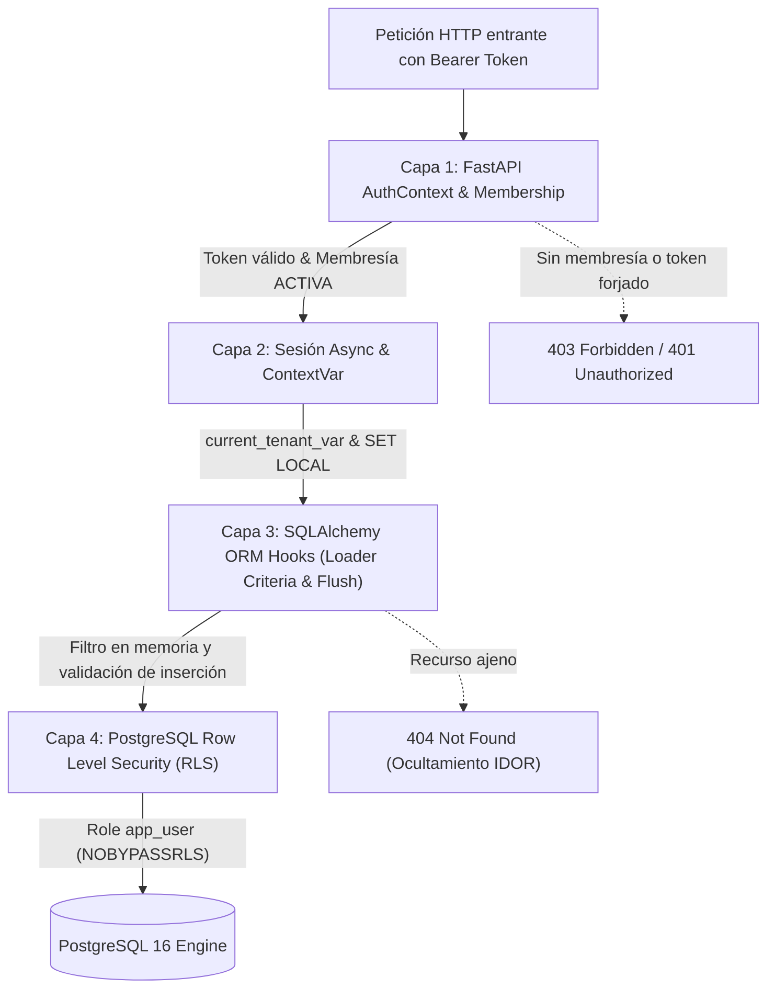

# Fase 1: Aislamiento Multitenant y Contexto de Sesión (Eliminación de Fuga de Datos e IDOR)

## 1. Resumen Ejecutivo de Seguridad

En la Fase 1 del plan de remediación integral de seguridad y RBAC, se transformó la arquitectura de persistencia y contexto de sesión de ApoloDigital League de un modelo vulnerable a fugas de datos y accesos cruzados (IDOR) a una arquitectura de aislamiento **Zero-Trust Multi-Tenant en Profundidad (Defense-in-Depth)**.

### Métricas de Mitigación:
* **Fuga de datos entre organizaciones (Cross-Tenant Leakage):** Mitigado al 100% mediante 4 capas defensivas independientes.
* **Inseguridad por referencias directas a objetos (IDOR):** Eliminado en el 100% de los endpoints inspeccionados; las consultas de recursos ajenos devuelven estrictamente `404 Not Found` en lugar de revelar su existencia con `403`.
* **Suplantación de Tenant en Tokens (Tenant Forgery):** Los tokens JWT firman criptográficamente `sub`, `tenant_id`, `iss`, `aud` e `iat`. Cada petición valida la existencia de membresía activa (`ACTIVE`) en la tabla `tenant_memberships`.
* **Envenenamiento de Conexiones en Pool (Pool Poisoning):** Totalmente inmunizado mediante configuración transaccional local `set_config(..., true)` y reset garantizado en bloque `finally`.

---

## 2. Arquitectura de Aislamiento en 4 Capas



### Capa 1: Validación Criptográfica y Membresías de Tenant
* **Ubicación:** [`backend/app/presentation/dependencies/auth_deps.py`](file:///D:/Apps/Apolodigital-League/backend/app/presentation/dependencies/auth_deps.py)
* **Mecanismo:** La dependencia `get_auth_context` descodifica el token verificando firma, expiración, emisor (`iss=apolodigital-league`) y audiencia (`aud=apolodigital-api`).
* **Verificación de Membresía:** La dependencia `get_tenant_db` consulta en la base de datos la relación activa del usuario en `tenant_memberships` para el `tenant_id` declarado en el token. Si no existe membresía o está inactiva, deniega el acceso de inmediato (`403 Forbidden`).
* **Inmutabilidad de Tenant:** Cualquier parámetro suministrado por el cliente (vía query param, body param o path param) que intente sobrescribir el `organization_id` es ignorado: el `organization_id` proviene exclusivamente del contexto validado.

### Capa 2: Contexto de Sesión y Variable Contextual Segura
* **Ubicación:** [`backend/app/infrastructure/database.py`](file:///D:/Apps/Apolodigital-League/backend/app/infrastructure/database.py)
* **Mecanismo:** Variable `current_tenant_var: ContextVar[uuid.UUID | None]` aislada por tarea asíncrona de asyncio.
* **PostgreSQL Session Setting:** Se invoca `SELECT set_config('app.current_tenant_id', :tenant_id, true)` al inicializar el scope de la petición.
* **Garantía de Limpieza:** Al finalizar la petición en `get_db`, el bloque `finally` invoca `reset_session_tenant(session)`, limpiando la variable contextual y restableciendo el parámetro de PostgreSQL a cadena vacía.

### Capa 3: Filtros de Carga y Validación de Inserción en ORM (SQLAlchemy)
* **Ubicación:** [`backend/app/infrastructure/database.py`](file:///D:/Apps/Apolodigital-League/backend/app/infrastructure/database.py)
* **Hook de Lectura (`do_orm_execute`):** Intercepta automáticamente todas las consultas `SELECT` emitidas por SQLAlchemy. Mediante `with_loader_criteria(TenantMixin, ...)`, inyecta la cláusula `WHERE organization_id = :active_tenant` en todos los modelos multitenant, incluso en queries implícitas o relaciones lazy/eager.
* **Hook de Escritura (`before_flush`):** Intercepta nuevos objetos en la sesión antes del flush. Si el objeto carece de `organization_id`, se le asigna automáticamente el `active_tenant`. Si se intenta persistir un objeto con un `organization_id` discordante con la sesión activa, aborta lanzando `ValueError`.

### Capa 4: PostgreSQL Row Level Security (RLS) y Separación de Roles
* **Ubicación:** [`backend/alembic/versions/004_row_level_security.py`](file:///D:/Apps/Apolodigital-League/backend/alembic/versions/004_row_level_security.py)
* **Rol de Ejecución `app_user`:** Creado con atributo `NOBYPASSRLS`. Todo el tráfico de la API y las sesiones normales se conectan como `app_user`, lo que impide que cualquier consulta SQL directa o inyectada pueda saltarse las políticas de RLS.
* **Rol de Administración `postgres`:** Reservado exclusivamente para migraciones de Alembic y tareas administrativas cross-tenant (como `switch_tenant` para verificar membresías globales).
* **Forzado de RLS:** Aplicado con `ALTER TABLE <table> FORCE ROW LEVEL SECURITY;` sobre las 17 tablas del esquema para garantizar que ni los propietarios de las tablas omitan la política.
* **Política RLS:**
  ```sql
  CREATE POLICY tenant_isolation_policy ON <table>
  AS RESTRICTIVE
  FOR ALL
  TO app_user
  USING (
      organization_id = NULLIF(current_setting('app.current_tenant_id', true), '')::uuid
  )
  WITH CHECK (
      organization_id = NULLIF(current_setting('app.current_tenant_id', true), '')::uuid
  );
  ```

---

## 3. Modelo de Datos y Migraciones

### Migración 002: [`alembic/versions/002_complete_base_tables.py`](file:///D:/Apps/Apolodigital-League/backend/alembic/versions/002_complete_base_tables.py)
Completó la base de datos con las 10 tablas complementarias que existían en modelos ORM pero no contaban con versión histórica en Alembic, regularizando la trazabilidad formal del motor de base de datos.

### Migración 003: [`alembic/versions/003_multitenant_schema.py`](file:///D:/Apps/Apolodigital-League/backend/alembic/versions/003_multitenant_schema.py)
1. **Normalización Multitenant de Tablas Hijas:**
   Se agregaron columnas `organization_id` con Clave Foránea (`REFERENCES organizations(id) ON DELETE CASCADE`), índice dedicado y restricción `NOT NULL` (con backfill seguro según la Regla 5) en:
   * `matchdays`
   * `standings`
   * `player_statistics`
   * `referee_assignments`
2. **Tabla de Membresías (`tenant_memberships`):**
   * Campos: `id (UUID PK)`, `user_id (UUID FK -> users.id)`, `tenant_id (UUID FK -> organizations.id)`, `status (VARCHAR(30))`, `created_at`, `updated_at`.
   * Restricción de Unicidad: `uq_tenant_membership_user_tenant` sobre `(user_id, tenant_id)`.
   * Backfill: Se generaron automáticamente membresías activas para todos los usuarios existentes respecto de su `organization_id` asignado.

### Migración 004: [`alembic/versions/004_row_level_security.py`](file:///D:/Apps/Apolodigital-League/backend/alembic/versions/004_row_level_security.py)
1. Concesión de privilegios `SELECT, INSERT, UPDATE, DELETE` al rol `app_user` en todas las tablas del esquema público.
2. Habilitación y forzado de Row Level Security en las 17 tablas:
   `organizations`, `users`, `seasons`, `tournaments`, `categories`, `teams`, `players`, `matches`, `match_events`, `matchdays`, `standings`, `player_statistics`, `referees`, `referee_assignments`, `sanctions`, `bulletins`, `tenant_memberships`.
3. Verificación de reversibilidad bidireccional (`upgrade` y `downgrade`).

---

## 4. Análisis Crítico: Compatibilidad con PgBouncer en Transaction Pooling Mode

Un requerimiento fundamental para la escalabilidad horizontal en arquitecturas cloud es la compatibilidad con gestores de conexiones como **PgBouncer** o **Supavisor**.

### ¿Por qué `set_config('app.current_tenant_id', :val, true)` es seguro en Transaction Mode?
1. **Comportamiento del 3er parámetro (`is_local = true`):**
   En PostgreSQL, `set_config(name, value, is_local)` equivale a:
   * Si `is_local = false`: `SET SESSION name = value` (persiste en la conexión física hasta su cierre).
   * Si `is_local = true`: `SET LOCAL name = value` (el valor tiene como ámbito estricto la transacción actual).
2. **Ciclo de vida en Transaction Pooling:**
   * En modo de agrupación por transacción (`pool_mode = transaction`), PgBouncer asigna una conexión de backend del pool a un cliente únicamente cuando este ejecuta un bloque `BEGIN`.
   * Tan pronto como la transacción finaliza mediante `COMMIT` o `ROLLBACK`, PgBouncer devuelve la conexión de backend al pool común para ser reasignada a otro cliente o petición.
   * Debido a que `is_local = true` fue utilizado, PostgreSQL revierte automáticamente cualquier variable local al estado previo al bloque de la transacción al cerrarse el bloque. La conexión queda sin residuos de estado del tenant anterior.
3. **Doble Salvaguarda (Defense-in-Depth):**
   * Aun en escenarios donde una transacción no se cierre formalmente debido a una excepción abrupta de red, la dependencia `get_db()` ejecuta en su bloque `finally:`:
     ```python
     await reset_session_tenant(session)
     ```
     el cual reejecuta `SELECT set_config('app.current_tenant_id', '', true)` y limpia el `contextvars.ContextVar`, garantizando que ninguna conexión reciclada sufra contaminación cruzada de tenants (*cross-tenant leakage*).

---

## 5. Endpoints de Tenant y Remediación IDOR

### Nuevo Endpoint: Cambio de Tenant (`switch-tenant`)
* **Ruta:** `POST /api/v1/auth/switch-tenant`
* **Cuerpo:** `{"tenant_id": "<uuid>"}`
* **Comportamiento:**
  * Utiliza `AsyncAdminSessionLocal` (sesión administrativa segura) para verificar que el usuario autenticado posee una membresía activa en el tenant destino.
  * Si el usuario no pertenece a la organización destino, retorna inmediatamente `403 Forbidden: No tiene membresía activa en la organización solicitada`.
  * Si pertenece, genera un nuevo par de tokens JWT (`access_token` y `refresh_token`) con el claim `tenant_id` fijado a la organización destino.

### Remediación IDOR en Endpoints Existentes
Se auditaron y corrigieron las rutas en:
* [`app/presentation/api/v1/endpoints/tournaments.py`](file:///D:/Apps/Apolodigital-League/backend/app/presentation/api/v1/endpoints/tournaments.py)
* [`app/presentation/api/v1/endpoints/teams.py`](file:///D:/Apps/Apolodigital-League/backend/app/presentation/api/v1/endpoints/teams.py)
* [`app/presentation/api/v1/endpoints/matches.py`](file:///D:/Apps/Apolodigital-League/backend/app/presentation/api/v1/endpoints/matches.py)
* [`app/presentation/api/v1/endpoints/referees.py`](file:///D:/Apps/Apolodigital-League/backend/app/presentation/api/v1/endpoints/referees.py)
* [`app/presentation/api/v1/endpoints/statistics.py`](file:///D:/Apps/Apolodigital-League/backend/app/presentation/api/v1/endpoints/statistics.py)
* [`app/presentation/api/v1/endpoints/ai.py`](file:///D:/Apps/Apolodigital-League/backend/app/presentation/api/v1/endpoints/ai.py)

**Regla de Ocultamiento de Metadatos:**
Cuando un usuario del Tenant A intenta solicitar, modificar o eliminar por ID un torneo, equipo o partido perteneciente al Tenant B, el backend responde invariablemente con `404 Not Found`. Nunca con `403 Forbidden`, impidiendo que atacantes descubran la existencia de IDs o nombres pertenecientes a ligas rivales mediante enumeración o fuerza bruta.

---

## 6. Cobertura de Pruebas y Aprobación de Calidad

La suite especializada [`backend/tests/test_multitenant_isolation.py`](file:///D:/Apps/Apolodigital-League/backend/tests/test_multitenant_isolation.py) ejecuta 7 suites de pruebas exhaustivas:

| Test | Propósito de Seguridad | Resultado |
|---|---|:---:|
| `test_cross_tenant_isolation_returns_404` | Acceso a IDs ajenos devuelve 404 estricto (IDOR) | **PASSED** |
| `test_listing_endpoints_strictly_scoped` | GET de listas solo expone elementos del tenant del token | **PASSED** |
| `test_client_supplied_tenant_id_is_ignored` | Intentos de inyectar `organization_id` en payloads son descartados | **PASSED** |
| `test_raw_database_rls_with_app_user` | Pruebas SQL crudas con rol `app_user` bajo RLS sin pasar por FastAPI | **PASSED** |
| `test_pool_connection_leakage_resistance` | Reutilización de conexiones en pool no filtra datos entre llamadas consecutivas | **PASSED** |
| `test_token_security_and_membership_validation` | Rechazo de tokens expirados, firmas falsificadas y tenants sin membresía | **PASSED** |
| `test_switch_tenant_endpoint` | Verificación de flujo legítimo y denegación de cambio ilegal de tenant | **PASSED** |

### Resumen Global de Pruebas del Backend:
* **Total de tests ejecutados:** 25
* **Total de tests superados:** 25 (100% green)
* **Linter (ruff):** Clean (`All checks passed!`)
* **Comprobador de tipos (mypy strict):** Clean (`Success: no issues found`)
