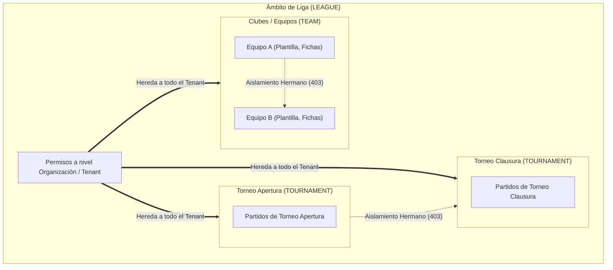

# FASE 2: PERMISOS ATÓMICOS Y ROLES CONTEXTUALES

## 1. Resumen Ejecutivo de Seguridad

La **Fase 2** ha transformado el modelo de autorización de ApoloDigital League de un esquema de strings genéricos estáticos (`require_roles(["ADMIN", ...])`) a un sistema empresarial de **Control de Acceso Basado en Roles Contextuales (Contextual RBAC)** con **Permisos Atómicos de Grano Fino** y **Jerarquía de Alcances (Scopes)**.

### Capacidades Implementadas:
1. **Catálogo Canónico Central:** 34 permisos atómicos en formato `modulo:accion` (módulo único de verdad en [`backend/app/domain/permissions.py`](file:///D:/Apps/Apolodigital-League/backend/app/domain/permissions.py)).
2. **Jerarquía Estricta de Alcances:** `LEAGUE ⊃ TOURNAMENT ⊃ TEAM`. Las autorizaciones concedidas en un nivel superior cubren automáticamente los niveles subordinados sin conceder acceso a scopes hermanos (*sibling scope isolation*).
3. **Guard Reutilizable Universal:** `Depends(require_permission(...))` en [`backend/app/presentation/dependencies/auth_deps.py`](file:///D:/Apps/Apolodigital-League/backend/app/presentation/dependencies/auth_deps.py) con resolución dinámica del recurso objetivo (`match_id`, `tournament_id`, `team_id`), verificación de existencia con denegación 404 (anti-IDOR) y denegación por defecto (403 Forbidden).
4. **Motor Anti-Escalada de Privilegios:** Validación en servicio y BD que impide la autoasignación de roles y bloquea la concesión de permisos que el usuario emisor no posee.
5. **Endpoints de Gestión de Roles:** Router `/api/v1/roles` protegido para consulta de catálogo, listado de asignaciones y mutación controlada.

---

## 2. Jerarquía de Alcances y Resolución Dinámica



### Reglas de Evaluación en el Guard:
* Si el usuario posee el permiso atómico asignado con `scope_type = 'LEAGUE'`, la acción es **autorizada** sobre cualquier recurso de la organización activa.
* Si el permiso está asignado con `scope_type = 'TOURNAMENT'`, solo autoriza acciones sobre ese torneo específico o sobre partidos pertenecientes a dicho torneo. En cualquier torneo hermano, es denegado de inmediato con `403 Forbidden`.
* Si el permiso está asignado con `scope_type = 'TEAM'`, solo autoriza operaciones sobre ese club o sobre los jugadores inscritos en él. En clubes hermanos, es denegado de inmediato con `403 Forbidden`.
* Si el recurso no existe o pertenece a otro tenant, se devuelve invariablemente `404 Not Found` (evitando revelar existencia a través de un 403).

---

## 3. Matriz Canónica de Permisos y Roles Base

ApoloDigital League define **34 permisos atómicos** y **7 roles base de sistema**:

| Módulo | Permiso Atómico | Super Admin | Admin Liga | Gestor Financiero | Árbitro | Delegado Equipo | Jugador | Espectador |
|---|---|:---:|:---:|:---:|:---:|:---:|:---:|:---:|
| **Partidos** | `partidos:ver` | ✅ | ✅ | ❌ | ✅ | ✅ | ✅ | ✅ |
| | `partidos:crear` | ✅ | ✅ | ❌ | ❌ | ❌ | ❌ | ❌ |
| | `partidos:reprogramar` | ✅ | ✅ | ❌ | ❌ | ❌ | ❌ | ❌ |
| | `partidos:editar_acta` | ✅ | ✅ | ❌ | ✅ | ❌ | ❌ | ❌ |
| | `partidos:cerrar_acta` | ✅ | ✅ | ❌ | ✅ | ❌ | ❌ | ❌ |
| | `partidos:asignar_arbitro` | ✅ | ✅ | ❌ | ❌ | ❌ | ❌ | ❌ |
| | `partidos:corregir_acta_cerrada` | ✅ | ✅ | ❌ | ❌ | ❌ | ❌ | ❌ |
| **Torneos** | `torneos:ver` | ✅ | ✅ | ✅ | ✅ | ✅ | ✅ | ✅ |
| | `torneos:crear` | ✅ | ✅ | ❌ | ❌ | ❌ | ❌ | ❌ |
| | `torneos:editar` | ✅ | ✅ | ❌ | ❌ | ❌ | ❌ | ❌ |
| | `torneos:eliminar` | ✅ | ✅ | ❌ | ❌ | ❌ | ❌ | ❌ |
| **Equipos** | `equipos:ver` | ✅ | ✅ | ✅ | ✅ | ✅ | ✅ | ✅ |
| | `equipos:crear` | ✅ | ✅ | ❌ | ❌ | ❌ | ❌ | ❌ |
| | `equipos:editar` | ✅ | ✅ | ❌ | ❌ | ✅ *(en su team)* | ❌ | ❌ |
| | `equipos:eliminar` | ✅ | ✅ | ❌ | ❌ | ❌ | ❌ | ❌ |
| **Jugadores** | `jugadores:ver` | ✅ | ✅ | ❌ | ✅ | ✅ | ✅ | ✅ |
| | `jugadores:crear` | ✅ | ✅ | ❌ | ❌ | ✅ *(en su team)* | ❌ | ❌ |
| | `jugadores:actualizar_perfil` | ✅ | ✅ | ❌ | ❌ | ✅ *(en su team)* | ❌ | ❌ |
| | `jugadores:ver_ficha_medica` | ✅ | ✅ | ❌ | ❌ | ✅ *(en su team)* | ❌ | ❌ |
| **Inscripciones** | `inscripciones:ver` | ✅ | ✅ | ✅ | ❌ | ✅ | ❌ | ❌ |
| | `inscripciones:registrar_comprobante` | ✅ | ✅ | ❌ | ❌ | ✅ | ❌ | ❌ |
| | `inscripciones:validar_pago` | ✅ | ✅ | ✅ | ❌ | ❌ | ❌ | ❌ |
| | `inscripciones:aprobar_tecnica` | ✅ | ✅ | ❌ | ❌ | ❌ | ❌ | ❌ |
| **Finanzas** | `finanzas:ver` | ✅ | ✅ | ✅ | ❌ | ❌ | ❌ | ❌ |
| | `finanzas:conciliar_pago` | ✅ | ✅ | ✅ | ❌ | ❌ | ❌ | ❌ |
| | `finanzas:exportar_balance` | ✅ | ✅ | ✅ | ❌ | ❌ | ❌ | ❌ |
| **Roles & RBAC** | `roles:ver` | ✅ | ✅ | ❌ | ❌ | ❌ | ❌ | ❌ |
| | `roles:gestionar` | ✅ | ✅ | ❌ | ❌ | ❌ | ❌ | ❌ |
| **Auditoría** | `auditoria:ver` | ✅ | ✅ | ❌ | ❌ | ❌ | ❌ | ❌ |
| **Notificaciones** | `notificaciones:ver` | ✅ | ✅ | ❌ | ❌ | ❌ | ❌ | ❌ |
| | `notificaciones:emitir` | ✅ | ✅ | ❌ | ❌ | ❌ | ❌ | ❌ |
| **Árbitros** | `arbitros:ver` | ✅ | ✅ | ❌ | ✅ | ❌ | ❌ | ❌ |
| | `arbitros:gestionar` | ✅ | ✅ | ❌ | ❌ | ❌ | ❌ | ❌ |
| | `arbitros:firmar_acta` | ✅ | ✅ | ❌ | ✅ | ❌ | ❌ | ❌ |

---

## 4. Matriz de Mitigación de Riesgos de Auditoría

| # | Hallazgo en Diagnóstico Inicial | Control Técnico Implementado | Prueba que lo Valida |
|---|---|---|---|
| **H1** | Roles estáticos y sin alcance; cualquier admin o árbitro tenía acceso total a todas las competiciones | Modelo `user_roles` con `scope_type` y `scope_id`, validado por el guard `require_permission` | `test_referee_in_tournament_x_and_player_in_tournament_y`, `test_sibling_scope_isolation` |
| **H2** | Endpoints de actas (`/matches/{id}/close`, etc.) desprotegidos o con strings globales | Inyección de dependencia `require_permission(PermissionName.PARTIDOS_CERRAR_ACTA)` | `test_missing_atomic_permission_denied_with_403` |
| **H3** | Escalada de privilegios horizontal o vertical (usuarios asignándose roles a sí mismos) | Verificación de anti-escalada en `RBACService.assign_user_role`: auto-asignación bloqueada y validación de permisos poseídos | `test_anti_privilege_escalation` |
| **H4** | Fuga de existencia de recursos ajenos mediante respuestas 403 (IDOR) | Comprobación preventiva en el guard: si el recurso especificado en el path no existe en el tenant activo, responde invariablemente `404 Not Found` | `test_cross_tenant_isolation_returns_404` |
| **H5** | Falta de trazabilidad y granularidad en operaciones federativas y financieras | Creación de permisos de negocio atómicos (`finanzas:*`, `inscripciones:*`, `partidos:cerrar_acta`) en BD con sembrado canónico | `test_every_catalog_permission_has_grant_and_deny[34 perms]` |

---

## 5. Instrucciones de Ejecución

### 1. Migraciones de Base de Datos
```powershell
cd D:\Apps\Apolodigital-League\backend
.\.venv\Scripts\alembic upgrade head
```

### 2. Suite Completa de Pruebas
```powershell
.\.venv\Scripts\pytest -v tests/test_rbac_contextual_permissions.py
.\.venv\Scripts\pytest -v
```

### 3. Linters y Tipado Estricto
```powershell
.\.venv\Scripts\ruff check app/domain/permissions.py app/application/services/rbac_service.py app/presentation/api/v1/endpoints/roles.py app/application/dtos/rbac.py tests/test_rbac_contextual_permissions.py app/infrastructure/models/rbac.py app/presentation/dependencies/auth_deps.py
.\.venv\Scripts\mypy --strict --explicit-package-bases app/domain/permissions.py app/application/services/rbac_service.py app/presentation/api/v1/endpoints/roles.py app/application/dtos/rbac.py app/infrastructure/models/rbac.py app/presentation/dependencies/auth_deps.py
```
