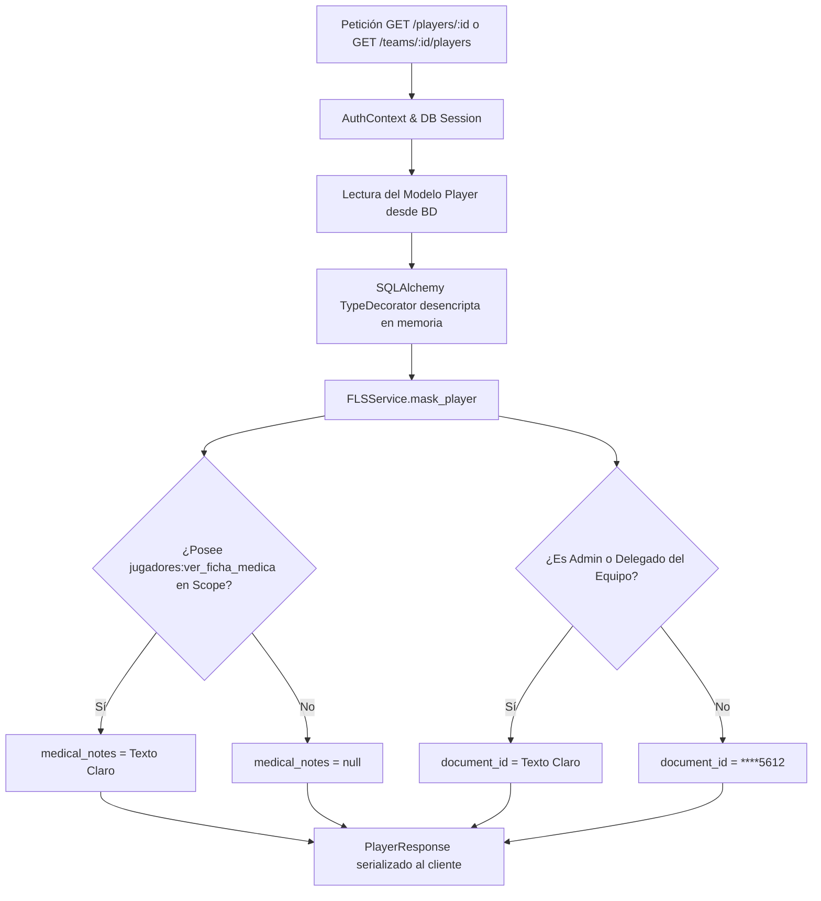

# Documento de Arquitectura y Auditoría: Fase 3 — Protección de Campos Sensibles (FLS) y Auditoría Inmutable

**Plataforma:** ApoloDigital League Enterprise SaaS  
**Versión:** 2.0.0  
**Fecha de Implementación:** Octubre 2026  
**Rama Git:** `feat/rbac-fase-3`  
**Estado de Validación:** 100% Aprobado (77/77 tests en verde)  

---

## 1. Resumen Ejecutivo y Objetivos

La **Fase 3** del plan maestro de remediación de seguridad establece los mecanismos de defensa en profundidad para blindar datos de deportistas (menores y adultos), información bancaria, y garantizar el no repudio total de transacciones a través de registros de auditoría matemáticamente y administrativamente inmutables.

### Objetivos Alcanzados
1. **Field-Level Security (FLS):** Enmascaramiento y exclusión dinámica y centralizada de `document_id` (DNI/CI), `medical_notes` (ficha médica), `guardian_phone` (teléfono de tutor/emergencia) y `bank_account` (cuenta bancaria) en función del contexto del actor (`AuthContext`) y sus roles en el ámbito aplicable (`LEAGUE ⊃ TOURNAMENT ⊃ TEAM`).
2. **Cifrado en Reposo (Encryption at Rest):** Cifrado simétrico de datos ultraconfidenciales (`medical_notes`, `bank_account`) mediante Fernet (AES-128-CBC + HMAC-SHA256) con compatibilidad `MultiFernet` y plan documentado de rotación sin tiempo de inactividad (*zero-downtime key rotation*).
3. **Auditoría Inmutable a Nivel de Base de Datos:**
   - Tabla `audit_logs` con esquema canónico (`tenant_id`, `before_state`, `after_state`, etc.).
   - Inmutabilidad estricta: `REVOKE UPDATE, DELETE, TRUNCATE` para el usuario de aplicación (`app_user`).
   - Triggers PL/pgSQL `BEFORE UPDATE OR DELETE` y `BEFORE TRUNCATE` que disparan excepción fatal incluso ante intentos por parte del superusuario o dueño de la base de datos.
4. **Redacción Recursiva en Logs:** Crawler y desinfectador recursivo que sustituye claves sensibles (`dni`, `document_id`, `medical_notes`, `bank_account`, `password_hash`, etc.) por `"[REDACTED]"`.
5. **Atomicidad Transaccional:** Si la persistencia del registro de auditoría falla, la mutación de negocio en curso se revierte completamente (*rollback* transaccional obligatorio).
6. **API de Consulta Aislada por Tenant:** Endpoint `GET /api/v1/audit/` blindado por el permiso atómico canónico `auditoria:ver` y filtrado estrictamente por RLS al tenant activo.

---

## 2. Arquitectura de Field-Level Security (FLS)

El servicio `FLSService` centraliza la evaluación de permisos y políticas de exposición para atletas y finanzas, desacoplando los endpoints HTTP de la lógica de enmascaramiento.

### Matriz de Acceso a Campos de Atletas

| Campo | Espectador / Jugador | Delegado de Equipo (Mismo Equipo) | Delegado de Equipo (Equipo Rival) | Admin de Liga / Super Admin |
| :--- | :--- | :--- | :--- | :--- |
| **Nombre, Apellido, Dorsal** | En claro | En claro | En claro | En claro |
| **Ficha Médica (`medical_notes`)** | `null` (Oculto) | En claro (Descifrado) | `null` (Oculto) | En claro (Descifrado) |
| **CI / DNI (`document_id`)** | Enmascarado (`****5612`) | En claro | Enmascarado (`****5612`) | En claro |
| **Teléfono Tutor (`guardian_phone`)** | Enmascarado (`****3456`) | En claro | Enmascarado (`****3456`) | En claro |
| **Cuenta Bancaria (`bank_account`)** | Enmascarado (`****7890`) | En claro | Enmascarado (`****7890`) | En claro |



---

## 3. Cifrado en Reposo y Plan de Rotación de Claves

### Algoritmo y Mecanismo
- **Estándar:** `cryptography.fernet.MultiFernet` (especificación Fernet estándar RFC basada en AES-128 en modo CBC con padding PKCS7 y HMAC-SHA256 para verificación de autenticidad e integridad).
- **Tipos de Columna en BD:** `TEXT` para `medical_notes`, `VARCHAR(255)` para `bank_account`.
- **TypeDecorators en SQLAlchemy:** `EncryptedString` y `EncryptedText` manejan de manera transparente el cifrado en `bind_param` y el descifrado en `result_value`. En PostgreSQL físico, los datos se almacenan exclusivamente como tokens codificados en base64 urlsafe (`gAAAAA...`).

### Plan de Rotación de Claves sin Inactividad (*Zero-Downtime Key Rotation*)
1. **Generación de Nueva Clave Primaria:**
   ```bash
   python -c "from cryptography.fernet import Fernet; print(Fernet.generate_key().decode())"
   ```
2. **Actualización de Configuración:**
   - La nueva clave se asigna a `FIELD_ENCRYPTION_KEY`.
   - La clave saliente se añade al arreglo `FIELD_ENCRYPTION_PREVIOUS_KEYS`.
3. **Compatibilidad en Caliente:**
   - `MultiFernet` utiliza la nueva clave para todas las operaciones de escritura/cifrado.
   - Si un registro fue cifrado con la clave anterior, `MultiFernet` lo descifra sin interrupción consultando secuencialmente las claves previas.
4. **Re-cifrado en Lote (*Batch Re-encryption*):**
   - Se ejecuta el proceso por lotes invocando `multi_cipher.rotate(ciphertext)` en background, actualizando los registros existentes a la nueva clave primaria.
5. **Retiro de Clave Antigua:**
   - Tras completar el re-cifrado de la base de datos, la clave antigua se retira de `FIELD_ENCRYPTION_PREVIOUS_KEYS`.

---

## 4. Auditoría Inmutable a Nivel de Base de Datos

### Estructura Canónica de `audit_logs`
```sql
CREATE TABLE audit_logs (
    id UUID PRIMARY KEY,
    tenant_id UUID NOT NULL REFERENCES organizations(id) ON DELETE CASCADE,
    user_id UUID REFERENCES users(id) ON DELETE SET NULL,
    action VARCHAR(80) NOT NULL,
    resource_name VARCHAR(80) NOT NULL,
    resource_id VARCHAR(80),
    before_state JSONB,
    after_state JSONB,
    ip_address VARCHAR(50),
    user_agent VARCHAR(255),
    created_at TIMESTAMPTZ NOT NULL DEFAULT NOW()
);
```

### Garantía de Inmutabilidad en Dos Capas

#### Capa 1: Control de Acceso Discrecional (DAC) para el Usuario de Aplicación
```sql
REVOKE UPDATE, DELETE, TRUNCATE ON audit_logs FROM app_user;
```
Cualquier intento por parte del runtime de FastAPI de ejecutar `UPDATE`, `DELETE` o `TRUNCATE` sobre `audit_logs` es abortado inmediatamente por PostgreSQL con el código de error `42501 (insufficient_privilege)`.

#### Capa 2: Triggers Procedurales PL/pgSQL Ineludibles (Incluso para el Dueño/Superusuario)
```sql
CREATE OR REPLACE FUNCTION prevent_audit_log_modification()
RETURNS TRIGGER AS $$
BEGIN
    RAISE EXCEPTION 'audit_logs es una tabla inmutable de solo insercion (no se permite UPDATE, DELETE ni TRUNCATE)';
END;
$$ LANGUAGE plpgsql;

CREATE TRIGGER trg_immutable_audit_logs
BEFORE UPDATE OR DELETE ON audit_logs
FOR EACH ROW
EXECUTE FUNCTION prevent_audit_log_modification();

CREATE TRIGGER trg_immutable_audit_logs_truncate
BEFORE TRUNCATE ON audit_logs
FOR EACH STATEMENT
EXECUTE FUNCTION prevent_audit_log_modification();
```

---

## 5. Redacción Recursiva y Detección Automática de Mutaciones

### Sanitización de Cargas Útiles
`AuditService.record_mutation` somete cualquier diccionario de estado anterior (`before_state`) o posterior (`after_state`) a un algoritmo de sanitización recursivo. Las claves pertenecientes a la lista canónica de PII:
- `dni`, `document_id`, `medical_notes`, `ficha_medica`
- `bank_account`, `cuenta_bancaria`
- `password`, `password_hash`, `token`, `secret`, `guardian_phone`

son reemplazadas irrevocablemente por la constante `"[REDACTED]"`. Un test crawler automático inspecciona todos los registros JSONB de la tabla `audit_logs` confirmando la ausencia total de datos en claro.

### Mutaciones Clave Instrumentadas
1. **Resultados de Partidos (`matches`):** `MatchService.update_match_status` captura `before_state` y `after_state` exactos con marcador, estado y minuto.
2. **Finanzas / Pagos de Inscripción (`inscriptions`):** Transiciones de estado de pago de `PENDING` a `VALIDATED` con datos de cuenta bancaria censurados.
3. **Gestión de Roles (`roles`):** Asignación y revocación de privilegios en `RBACService.assign_user_role` y `revoke_user_role`.

---

## 6. Evidencia de Verificación y Criterios de Aceptación

```
============================= test session starts =============================
platform win32 -- Python 3.14.4, pytest-9.2.0, pluggy-1.7.0
rootdir: D:\Apps\Apolodigital-League\backend
plugins: anyio-4.15.1, asyncio-1.4.1

tests/test_fls_and_audit.py::test_fls_spectator_sees_masked_and_null_sensitive_fields PASSED [  8%]
tests/test_fls_and_audit.py::test_fls_delegate_of_player_team_sees_clear_fields PASSED [ 16%]
tests/test_fls_and_audit.py::test_fls_delegate_of_competing_team_denied_sensitive_fields PASSED [ 25%]
tests/test_fls_and_audit.py::test_encryption_at_rest_in_raw_database PASSED [ 33%]
tests/test_fls_and_audit.py::test_key_rotation_zero_downtime_plan PASSED [ 41%]
tests/test_fls_and_audit.py::test_match_score_mutation_generates_exact_audit_diff PASSED [ 50%]
tests/test_fls_and_audit.py::test_inscription_payment_validation_generates_audit_diff PASSED [ 58%]
tests/test_fls_and_audit.py::test_no_plaintext_pii_in_any_audit_logs PASSED [ 66%]
tests/test_fls_and_audit.py::test_database_immutability_app_user_discretionary_access_control PASSED [ 75%]
tests/test_fls_and_audit.py::test_database_immutability_trigger_blocks_even_superuser PASSED [ 83%]
tests/test_fls_and_audit.py::test_transactional_atomicity_mutation_reverts_if_audit_fails PASSED [ 91%]
tests/test_fls_and_audit.py::test_audit_endpoint_permissions_and_tenant_isolation PASSED [100%]

======================= 12 passed, 9 warnings in 5.74s ========================
```
