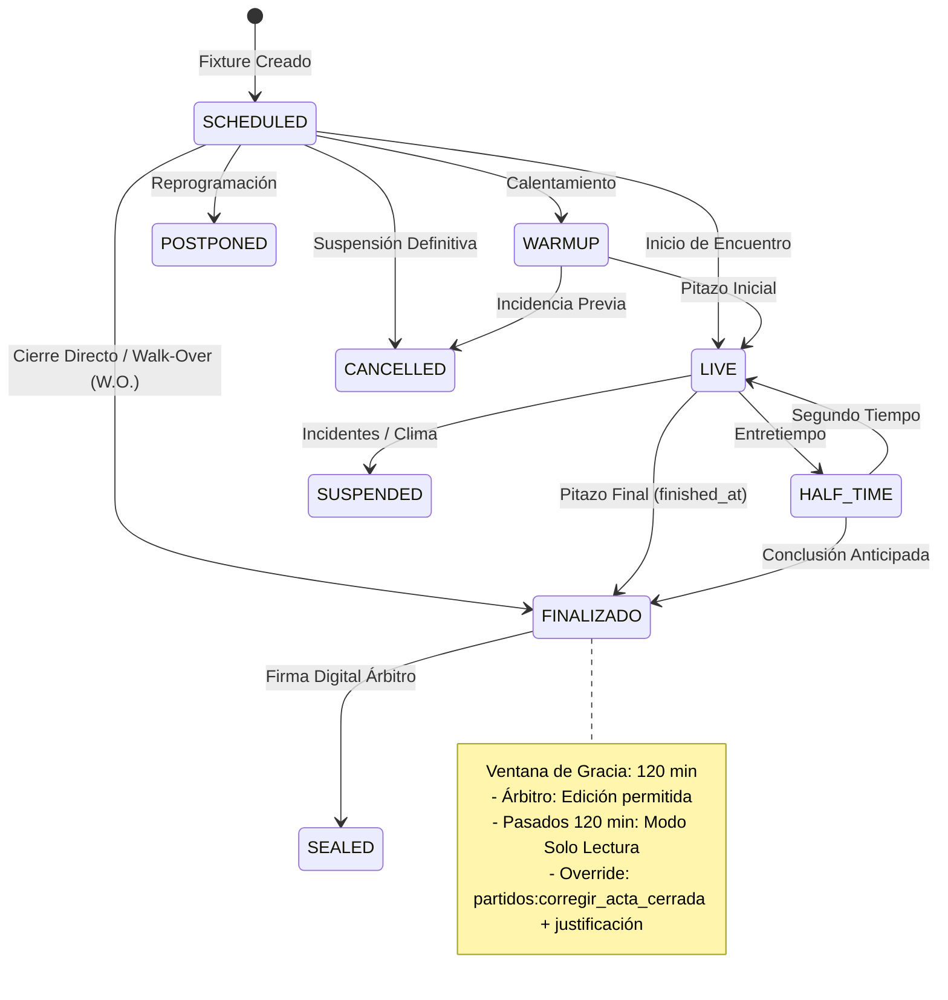
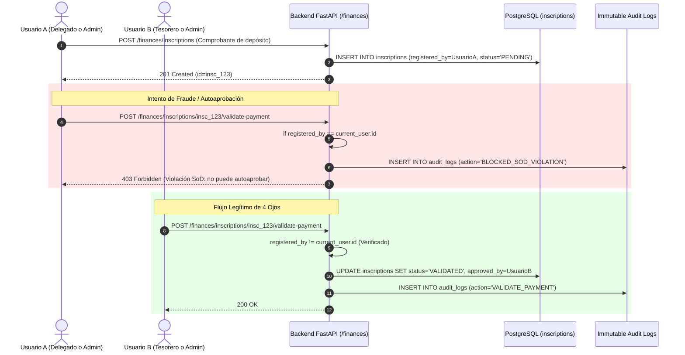

# Documento de Arquitectura y Auditoría: Fase 4 — Acceso por Estado/Tiempo y Segregación de Funciones (SoD)

**Plataforma:** ApoloDigital League Enterprise SaaS  
**Versión:** 2.0.0  
**Fecha de Implementación:** Octubre 2026  
**Rama Git:** `feat/rbac-fase-4`  
**Estado de Validación:** 100% Aprobado (89/89 tests en verde, Ruff 100% limpio, Mypy 100% limpio)  

---

## 1. Resumen Ejecutivo y Objetivos

La **Fase 4** del plan maestro de remediación de seguridad implementa controles de gobierno temporal, integridad de estado y segregación estricta de funciones (*Segregation of Duties / 4-Eyes Principle*). El objetivo principal es mitigar de forma definitiva el riesgo de fraude en planillas de juego/resultados deportivos y en la validación de tesorería/inscripciones.

### Objetivos Alcanzados
1. **Gobierno Temporal de Actas Arbitrales (Ventana de Gracia):**
   - El árbitro solo puede modificar marcador, incidencias y notas mientras el partido se encuentre en curso (`EN_JUEGO` / `LIVE`) o durante la ventana de gracia reglamentaria posterior al pitazo final (configurable vía `settings.MATCH_GRACE_PERIOD_MINUTES`, por defecto 120 minutos).
   - Cálculo temporal estricto en el servidor usando `datetime.now(timezone.utc)` y `finished_at`. Es **100% inmune a manipulación de cabeceras HTTP** (`Date`, `X-Client-Timestamp`) o campos de fecha en payloads de los clientes.
   - Tras el vencimiento de la ventana de gracia, el acta pasa automáticamente a modo **solo lectura (*read-only*)**.
2. **Corrección de Acta Cerrada con Justificación Obligatoria:**
   - La alteración de un acta fuera de la ventana de gracia exige el permiso atómico `partidos:corregir_acta_cerrada`.
   - Requiere un motivo o justificación formal (`justification`) no vacío; solicitudes sin justificación son rechazadas con `400 Bad Request`.
   - Las justificaciones quedan consolidadas en `matches.correction_notes` y en el registro inmutable de auditoría con la acción `UPDATE_MATCH_SCORE_CORRECTION_OVERRIDE` o `RECORD_MATCH_EVENT_CORRECTION_OVERRIDE`.
3. **Máquina de Estados de Ciclo de Vida del Partido:**
   - Formalización de transiciones válidas (`SCHEDULED` -> `WARMUP` -> `LIVE` -> `HALF_TIME` -> `FINALIZADO` -> `SEALED`).
   - Bloqueo tajante de regresiones ilegales (`FINALIZADO` -> `SCHEDULED`) o resucitación de encuentros cancelados (`CANCELLED` -> `LIVE`), respondiendo `400 Bad Request`.
   - Bloqueo de registro de incidencias en partidos no iniciados (`SCHEDULED`).
4. **Segregación de Funciones (Principio de 4 Ojos en Tesorería):**
   - El usuario que registra o sube un comprobante de pago (`registered_by`) **no puede validarlo ni aprobarlo** (`approved_by`). Aplica universalmente a Administradores de Liga, Tesoreros y Delegados de Equipo.
   - Refuerzo en capa de servicio y a nivel de motor de base de datos con constraint `chk_inscriptions_sod_4eyes`.
5. **Auditoría Inmutable de Bloqueos de Seguridad:**
   - Todo intento bloqueado por vencimiento de gracia genera un log `BLOCKED_EXPIRED_MATCH_SHEET_EDIT`.
   - Todo intento de autoaprobación de pagos genera un log `BLOCKED_SOD_VIOLATION`.

---

## 2. Máquina de Estados del Partido y Ventana de Gracia

### 2.1. Ciclo de Vida y Transiciones Válidas



### 2.2. Reglas de Transición y Excepciones

| Estado Origen | Estados Destino Permitidos | Transiciones Prohibidas | Código HTTP Rechazo |
| :--- | :--- | :--- | :--- |
| `SCHEDULED` | `WARMUP`, `LIVE`, `EN_JUEGO`, `POSTPONED`, `CANCELLED`, `FINALIZADO` | Intentar registrar incidencias (goles, tarjetas) sin iniciar | `400 Bad Request` |
| `LIVE` / `EN_JUEGO` | `HALF_TIME`, `DESCANSO`, `FINALIZADO`, `FINISHED`, `SUSPENDED`, `CANCELLED` | Regresión a `SCHEDULED` o `WARMUP` | `400 Bad Request` |
| `FINALIZADO` | `SEALED`, `CERRADO` | `SCHEDULED`, `WARMUP`, `POSTPONED` (reversión fraudulenta) | `400 Bad Request` |
| `CANCELLED` | *Ninguno (Estado terminal)* | `LIVE`, `FINALIZADO` | `400 Bad Request` |

---

## 3. Gobierno Temporal e Inmunidad al Reloj del Cliente

### 3.1. Algoritmo de Verificación de Gracia en `MatchService`

```mermaid
flowchart TD
    Req[Petición PUT /matches/:id o POST /events] --> StatusCheck{¿Estado en FINISHED_STATUSES?}
    StatusCheck -- No (LIVE o WARMUP) --> AllowRef[Permitir edición al Árbitro]
    StatusCheck -- Sí (FINALIZADO / SEALED) --> CalcTime[now_utc = datetime.now(timezone.utc)<br>elapsed = now_utc - match.finished_at]
    CalcTime --> GraceCheck{¿elapsed <= 120 min?}
    GraceCheck -- Sí --> AllowRef
    GraceCheck -- No --> CheckPerm{¿Usuario tiene 'partidos:corregir_acta_cerrada'?}
    CheckPerm -- No --> LogBlock[Audit: BLOCKED_EXPIRED_MATCH_SHEET_EDIT<br>Commit transaccional] --> Deny403[403 Forbidden: Ventana de gracia expirada]
    CheckPerm -- Sí --> CheckJust{¿justification provista y >= 5 caracteres?}
    CheckJust -- No --> Deny400[400 Bad Request: Justificación obligatoria requerida]
    CheckJust -- Sí --> ApplyCorr[Guardar en match.correction_notes<br>Audit: UPDATE_MATCH_SCORE_CORRECTION_OVERRIDE<br>200 OK]
```

### 3.2. Inmunidad Contra Spoofing de Cabeceras
La verificación del servidor no consulta parámetros de la petición como `Date`, `X-Client-Timestamp` o campos en el cuerpo JSON. La referencia temporal se evalúa exclusivamente contrastando el reloj monótono del host/contenedor (`datetime.now(timezone.utc)`) frente a la marca de tiempo `matches.finished_at` registrada en PostgreSQL durante el cierre reglamentario.

---

## 4. Segregación de Funciones (Principio de 4 Ojos) en Tesorería

Para evitar fraudes internos y autoaprobaciones de fondos o pagos ficticios, se implementa una política de doble control (*Four-Eyes Principle*):



### 4.1. Doble Defensa: Servicio y Base de Datos

1. **Capa de Aplicación (`finances.py`):**
   ```python
   if item.registered_by and item.registered_by == current_user.id:
       await AuditService.record_mutation(
           session=db,
           tenant_id=auth.tenant_id,
           action="BLOCKED_SOD_VIOLATION",
           resource_name="inscriptions",
           resource_id=str(item.id),
           ...
       )
       await db.commit()
       raise HTTPException(status_code=403, detail="Violación de Segregación de Funciones (SoD / 4 Ojos)...")
   ```
2. **Capa de Base de Datos (Migración 007):**
   ```sql
   ALTER TABLE inscriptions ADD CONSTRAINT chk_inscriptions_sod_4eyes
   CHECK (approved_by IS NULL OR registered_by IS NULL OR approved_by <> registered_by);
   ```
   Cualquier script malicioso o inserción SQL directa que intente fijar `approved_by == registered_by` resulta en un fallo inmediato `IntegrityError (NotNull/CheckViolationError)`.

---

## 5. Matriz de Mitigación de Riesgos de Auditoría

| Hallazgo Original (`docs/auditoria.md`) | Control Implementado en Fase 4 | Prueba Automatizada de Validación |
| :--- | :--- | :--- |
| **Manipulación Extemporánea de Actas:** Árbitros o directivos podían alterar marcadores horas o días después del partido. | Ventana de gracia de 120 min computada estrictamente por el reloj del servidor UTC; modo solo lectura automático posterior. | `test_referee_blocked_after_grace_period_expired` |
| **Bypass de Tiempo vía Cliente:** Manipulación de cabeceras de cliente para engañar al backend sobre la hora real del cierre. | Servidor ignora cabeceras `Date`/`X-Client-Timestamp` y calcula la diferencia únicamente usando `datetime.now(timezone.utc)`. | `test_client_headers_or_payload_timestamps_cannot_bypass_grace_period` |
| **Modificaciones Clandestinas sin Motivo:** Correcciones posteriores sin trazabilidad ni justificación formal. | Requisito de permiso `partidos:corregir_acta_cerrada` y parámetro `justification` obligatorio. Registro en `correction_notes` y auditoría. | `test_admin_with_permission_and_justification_can_correct_closed_match` y `test_admin_without_justification_rejected_with_400` |
| **Inconsistencias en Ciclo de Vida del Partido:** Reversión fraudulenta de partidos finalizados a estados iniciales. | Máquina de estados formal que prohíbe transiciones ilegales (`FINALIZADO -> SCHEDULED`, `CANCELLED -> LIVE`). | `test_state_machine_invalid_reversion_rejected` |
| **Goles Fantasma en Partidos no Iniciados:** Inserción de eventos en partidos programados que aún no se juegan. | Validación que exige que el partido esté en curso o en gracia para admitir eventos. | `test_record_events_on_unstarted_match_rejected` |
| **Autoaprobación de Pagos (Fraude de Tesorería):** Delegado o Admin registra un comprobante propio y se lo autoaprueba. | Principio de 4 Ojos forzado en API (`403 Forbidden`) y en PostgreSQL mediante constraint `chk_inscriptions_sod_4eyes`. | `test_admin_cannot_approve_own_registration_voucher`, `test_delegate_cannot_approve_own_registration_voucher` y `test_raw_database_check_constraint_blocks_self_approval` |

---

## 6. Procedimiento de Ejecución y Puertas de Calidad

### Migraciones
```bash
./.venv/Scripts/alembic upgrade head
```

### Ejecución de Pruebas
```bash
# Suite exclusiva de la Fase 4
./.venv/Scripts/pytest -v tests/test_state_and_sod.py

# Suite global de regresión
./.venv/Scripts/pytest -v
```

### Verificación de Estilo y Tipado
```bash
./.venv/Scripts/ruff check app alembic tests
./.venv/Scripts/mypy --explicit-package-bases app/config.py app/infrastructure/models/match.py app/application/dtos/match.py app/application/services/match_service.py app/presentation/api/v1/endpoints/matches.py app/presentation/api/v1/endpoints/finances.py app/presentation/api/v1/endpoints/discipline.py app/presentation/api/v1/endpoints/referees.py app/application/services/tournament_service.py tests/test_state_and_sod.py
```
