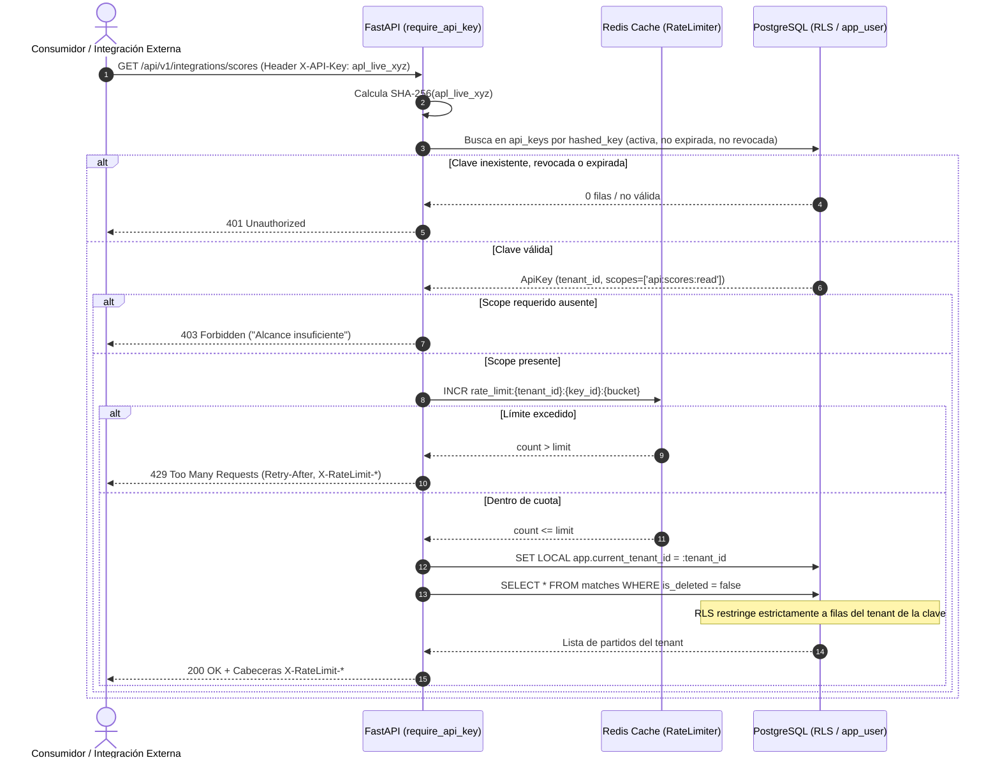
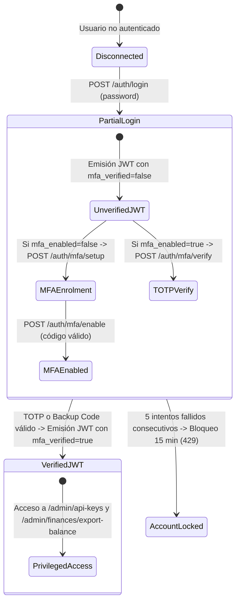

# Documento de Arquitectura y Auditoría: Fase 5 — Gobierno de APIs, Rate Limiting Multi-Tenant, MFA (TOTP) y Endpoints de Administración

**Plataforma:** ApoloDigital League Enterprise SaaS  
**Versión:** 2.0.0  
**Fecha de Implementación:** Octubre 2026  
**Rama Git:** `feat/rbac-fase-5`  
**Estado de Validación:** 100% Aprobado (101/101 tests en verde, Ruff 100% limpio, Mypy --strict 100% limpio, Alembic downgrade/upgrade verificado)  

---

## 1. Resumen Ejecutivo y Objetivos

La **Fase 5** constituye la cúspide del plan maestro de remediación de seguridad de ApoloDigital League. Aborda el aseguramiento de integraciones de consumo exterior (medios de comunicación, widgets telemétricos, emisoras radiales) y el endurecimiento crítico de cuentas y operaciones de super-administración.

### Objetivos Alcanzados
1. **API Keys con Scopes Granulares y Alta Entropía:**
   - Generación de claves seguras de 32 bytes URL-safe con prefijo identificable `apl_live_`.
   - **Principio de Mínima Exposición:** la clave en texto plano se exhibe una sola vez al usuario/cliente. En base de datos se almacena **estrictamente su hash criptográfico SHA-256** (64 caracteres hexadecimales) y el prefijo de 12 caracteres.
   - Vinculación obligatoria a un tenant (`organization_id`), con scopes atómicos (`api:scores:read`, `api:stats:read`, `api:live:write`), estado de revocación, fecha de expiración y registro de último uso.
   - Dependencia de autenticación independiente del ciclo JWT (`require_api_key`), que valida el hash, verifica scopes, aplica RLS local en la sesión y ejecuta rate limiting.
2. **Rate Limiting Multi-Tenant Distribuido en Redis:**
   - Contadores atómicos en Redis particionados por tenant y por consumidor: `rate_limit:{tenant_id}:{identifier}:{window_bucket}`.
   - Emisión de cabeceras HTTP estándar en cada respuesta: `Retry-After`, `X-RateLimit-Limit`, `X-RateLimit-Remaining`, `X-RateLimit-Reset`.
   - Respuesta HTTP `429 Too Many Requests` ante ráfagas que superen el límite.
   - **Aislamiento Multi-Tenant Absoluto:** las peticiones excesivas en un tenant jamás degradan el servicio ni bloquean a los demás tenants.
   - Comportamiento resiliente **Fail-Closed** en rutas administrativas y de integraciones sensibles (emite `503 Service Unavailable` si Redis se desconecta).
3. **Autenticación Multifactor (MFA / TOTP) Obligatoria para Cuentas Privilegiadas:**
   - Enrolamiento de MFA mediante protocolo TOTP (RFC 6238, Google Authenticator / Authy).
   - **Cifrado en Reposo de Secretos TOTP:** el secreto Base32 se almacena cifrado con Fernet (AES-128-CBC + HMAC-SHA256).
   - **8 Códigos de Respaldo de Un Solo Uso:** generados aleatoriamente y guardados únicamente como hashes SHA-256. Al utilizarse un código de respaldo, se consume y elimina inmediatamente del arreglo para imposibilitar ataques de repetición (*anti-replay*).
   - Claim `mfa_verified` y `mfa_required` en tokens JWT. El inicio de sesión con credenciales básicas de un rol privilegiado (`SUPER_ADMIN`, `ADMIN_LIGA`, `GESTOR_FINANCIERO`) emite `mfa_verified: false`; el acceso a rutas protegidas es denegado con `403 Forbidden` hasta validar el segundo factor en `/api/v1/auth/mfa/verify`.
   - Bloqueo temporal automático de cuenta (15 minutos, `429 Too Many Requests`) tras 5 intentos fallidos consecutivos de MFA.
4. **Agrupación y Blindaje de Endpoints de Administración:**
   - Router `/api/v1/admin` que consolida la creación, listado y revocación de API Keys, y la exportación de balances de tesorería.
   - Exige de forma acumulativa: contexto de tenant activo, rol atómico verificado y claim `mfa_verified: true`.
5. **No Repudio y Auditoría Inmutable:**
   - Mutaciones administrativas (`CREATE_API_KEY`, `REVOKE_API_KEY`, `MFA_SETUP_INITIATED`, `MFA_AUTHENTICATION_SUCCESS`) registradas con diffs exactos.
   - Las claves de API en claro, secretos TOTP y hashes completos son **redactados sistemáticamente** en la capa de auditoría (`[REDACTED]`).

---

## 2. Diagrama de Arquitectura y Flujo de Autenticación



---

## 3. Modelo de Datos y Migración Alembic (008)

### 3.1. Campos MFA en la Tabla `users`
- `mfa_enabled`: Booleano que indica si el segundo factor está formalmente activo.
- `mfa_secret_encrypted`: Secreto TOTP Base32 cifrado mediante Fernet.
- `mfa_backup_codes`: Columna `JSONB` que almacena una lista de hashes SHA-256 de los 8 códigos de respaldo disponibles.
- `mfa_failed_attempts`: Contador de fallos consecutivos.
- `mfa_locked_until`: Timestamp UTC hasta el cual la verificación permanece suspendida por exceso de fallos.

### 3.2. Tabla `api_keys` con Row-Level Security
```sql
CREATE TABLE api_keys (
    id UUID PRIMARY KEY,
    organization_id UUID NOT NULL REFERENCES organizations(id) ON DELETE CASCADE,
    name VARCHAR(100) NOT NULL,
    prefix VARCHAR(16) NOT NULL,
    hashed_key VARCHAR(255) NOT NULL UNIQUE,
    scopes JSONB NOT NULL DEFAULT '[]'::jsonb,
    created_by UUID REFERENCES users(id) ON DELETE SET NULL,
    expires_at TIMESTAMPTZ,
    revoked_at TIMESTAMPTZ,
    is_active BOOLEAN NOT NULL DEFAULT true,
    last_used_at TIMESTAMPTZ,
    created_at TIMESTAMPTZ NOT NULL DEFAULT now(),
    updated_at TIMESTAMPTZ NOT NULL DEFAULT now(),
    is_deleted BOOLEAN NOT NULL DEFAULT false
);

CREATE INDEX ix_api_keys_organization_id ON api_keys (organization_id);
CREATE INDEX ix_api_keys_prefix ON api_keys (prefix);
CREATE UNIQUE INDEX ix_api_keys_hashed_key ON api_keys (hashed_key);

-- Row-Level Security
ALTER TABLE api_keys ENABLE ROW LEVEL SECURITY;
ALTER TABLE api_keys FORCE ROW LEVEL SECURITY;

CREATE POLICY tenant_isolation_policy ON api_keys FOR ALL TO app_user
USING (organization_id = NULLIF(current_setting('app.current_tenant_id', true), '')::uuid)
WITH CHECK (organization_id = NULLIF(current_setting('app.current_tenant_id', true), '')::uuid);

GRANT SELECT, INSERT, UPDATE, DELETE ON api_keys TO app_user;
```

---

## 4. Matriz de Scopes de API Keys

| Scope Atómico | Descripción Operativa | Rutas Autorizadas |
|---|---|---|
| `api:scores:read` | Consulta pública/externa de marcadores y resultados de partidos. | `GET /api/v1/integrations/scores` |
| `api:stats:read` | Lectura de tablas de posiciones, goleadores y estadísticas acumuladas. | `GET /api/v1/integrations/stats` |
| `api:live:write` | Actualización telemétrica o en vivo del marcador y minuto de juego de un encuentro. | `POST /api/v1/integrations/live-update` |

---

## 5. Implementación de Rate Limiting Multi-Tenant

El limitador `RateLimiter` (`backend/app/infrastructure/rate_limiter.py`) implementa ventanas fijas con expiración automática en Redis:

- **Estructura de Clave:** `rate_limit:{tenant_id}:{identifier}:{window_bucket}`
- **Cabeceras HTTP de Respuesta:**
  - `X-RateLimit-Limit`: Cantidad máxima autorizada de peticiones en la ventana.
  - `X-RateLimit-Remaining`: Peticiones restantes antes del bloqueo.
  - `X-RateLimit-Reset`: Segundos restantes para el reinicio de la ventana de cuota.
  - `Retry-After`: Segundos que el cliente debe aguardar antes de reintentar (incluida en HTTP 429).
- **Aislamiento Multi-Tenant:** La inclusión del `tenant_id` en el prefijo de clave impide colisiones o denegación de servicio inducida entre organizaciones cliente.

---

## 6. Ciclo de Vida de Autenticación Multifactor (MFA)



---

## 7. Pruebas y Cobertura de la Fase 5

El archivo [`backend/tests/test_api_keys_and_mfa.py`](file:///D:/Apps/Apolodigital-League/backend/tests/test_api_keys_and_mfa.py) contiene 12 pruebas exhaustivas de aceptación:

| Prueba | Escenario de Verificación | Resultado |
|---|---|---|
| `test_api_key_valid_scope_success` | Clave con scope `api:scores:read` consulta marcadores de su tenant | **PASSED** (200 OK) |
| `test_api_key_insufficient_scope_forbidden` | Clave con `api:scores:read` intenta mutar en `/live-update` (`api:live:write`) | **PASSED** (403 Forbidden) |
| `test_api_key_revoked_unauthorized` | Clave con marca `is_active=false` o `revoked_at` establecido | **PASSED** (401 Unauthorized) |
| `test_api_key_expired_unauthorized` | Clave con `expires_at` en el pasado | **PASSED** (401 Unauthorized) |
| `test_api_key_rate_limiting_and_tenant_isolation` | Ráfaga sobre límite genera 429 + Retry-After; otro tenant no se ve afectado | **PASSED** (429 / 200 OK) |
| `test_api_key_cross_tenant_isolation_returns_404` | Clave de Liga A intentando actualizar partido de Liga B | **PASSED** (404 Not Found) |
| `test_privileged_user_without_mfa_forbidden` | Usuario `ADMIN_LIGA` con `mfa_verified: false` intenta exportar balance | **PASSED** (403 Forbidden) |
| `test_mfa_setup_and_enable` | Generación de secreto cifrado en reposo, 8 códigos de respaldo y confirmación | **PASSED** (200 OK) |
| `test_mfa_totp_verification_grants_verified_token` | TOTP válido emite token con `mfa_verified: true`, permitiendo acceso a `/admin` | **PASSED** (200 OK) |
| `test_mfa_backup_code_single_use_consumption` | Código de respaldo funciona una vez y es consumido; reutilización rechazada | **PASSED** (200 OK / 401) |
| `test_mfa_lockout_after_5_failed_attempts` | 5 códigos inválidos consecutivos bloquean temporalmente la cuenta | **PASSED** (429 Too Many Req) |
| `test_no_plaintext_keys_or_secrets_in_db_or_audit_logs` | Verificación directa en BD y audit_logs de ausencia de texto plano | **PASSED** (SHA-256 / Fernet) |

---

## 8. Puerta de Salida y Certificación de Calidad

- **Alembic Reversibility:** `alembic downgrade -1` aplicado limpiamente a `007` y `alembic upgrade head` restaurado sin errores.
- **Pytest:** **101 tests passed**, 0 failed en 47.11s.
- **Ruff:** `ruff check app tests` -> `All checks passed!`.
- **Mypy:** `mypy --strict --explicit-package-bases` sobre todos los módulos de la fase -> `Success: no issues found in 7 source files`.
